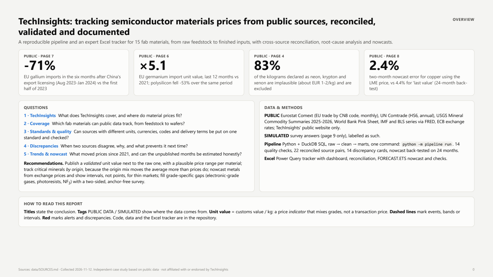
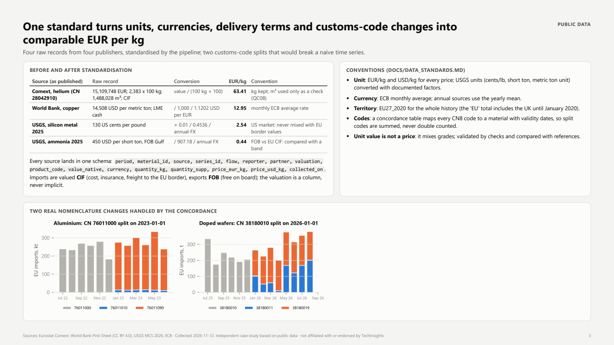
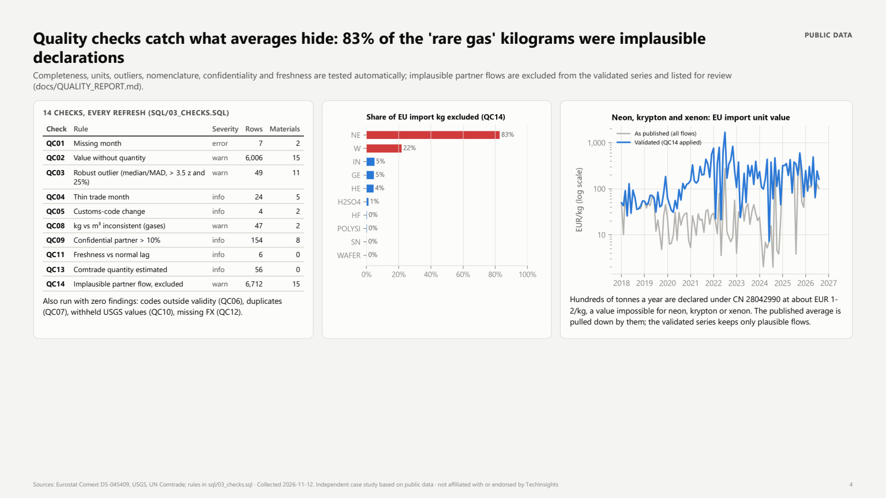
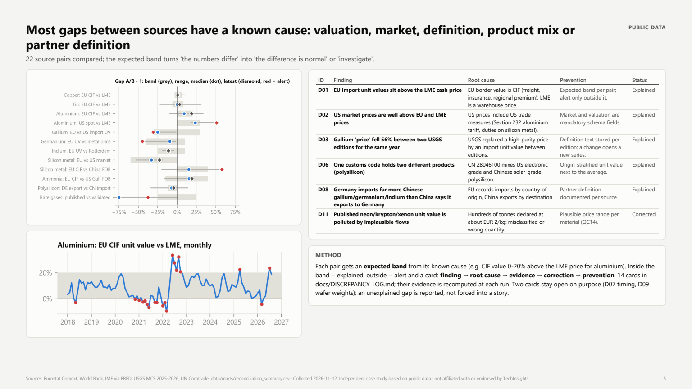
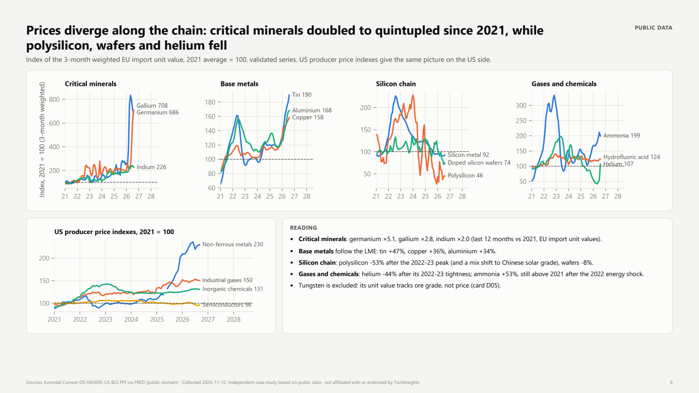
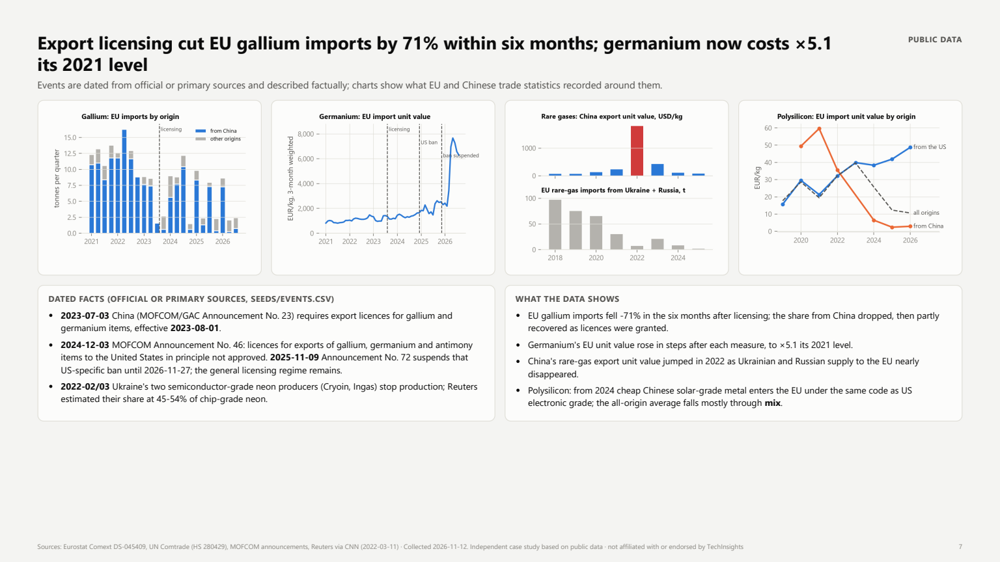
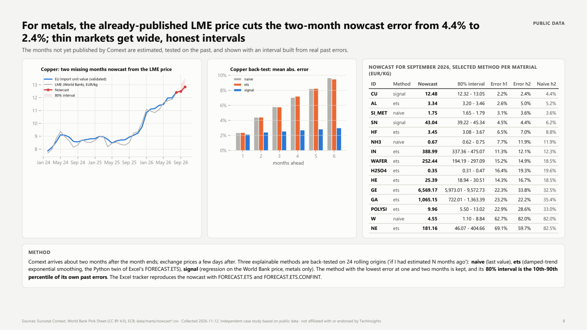

# TechInsights: tracking semiconductor materials prices from public sources

**A reproducible pipeline and an expert Excel tracker for 15 fab materials, from raw feedstock to finished inputs, with cross-source reconciliation, root-cause analysis and nowcasts.**

Independent case study built for a *Data Analyst - semiconductor materials pricing* application.
It uses **public data only** and is **not affiliated with or endorsed by TechInsights**; no TechInsights or TECHCET figures are used.

- Report (11 pages, PDF): [docs/TechInsights_MaterialsPricing_CaseStudy.pdf](docs/TechInsights_MaterialsPricing_CaseStudy.pdf)
- Excel tracker (Power Query, dashboard, reconciliation, FORECAST.ETS nowcast): [excel/Semiconductor_Materials_Price_Tracker.xlsx](excel/Semiconductor_Materials_Price_Tracker.xlsx)

## Key results
| | Result | Data |
|---|---|---|
| **-71%** | EU gallium imports in the six months after China's export licensing (Aug 2023-Jan 2024) vs the first half of 2023 | Eurostat Comext |
| **×5.1** | EU germanium import unit value, last 12 months vs 2021; over the same period polysilicon fell 53% and doped wafers 8% | Eurostat Comext |
| **83%** | of the kilograms declared as neon/krypton/xenon are implausible (about EUR 1-2/kg) and are excluded by a plausibility check | Eurostat Comext |
| **2.4% vs 4.4%** | two-month nowcast error for copper using the already-published LME price, vs "last value" (24-month back-test) | Comext, World Bank |



| | |
|---|---|
|  |  |
|  |  |
|  |  |

## Questions and answers
| # | Question | Answer |
|---|---|---|
| 1 | Which fab materials can public data track? | All 15 have a monthly EU trade series (Comext, CN8); only copper, tin and aluminium have a second monthly price (LME via World Bank and IMF). Photoresists, NF3, precursors and CMP slurries have no public price. |
| 2 | Can sources with different units, currencies, codes and delivery terms share one standard? | Yes: one schema (`data/clean/observations.csv`), EUR/kg and USD/kg for every price, explicit CIF/FOB valuation, EU27_2020 territory, and a code concordance that handles two real customs-code splits (aluminium 2023, wafers 2026). |
| 3 | When two sources disagree, why? | 22 source pairs, each with an expected band. Most gaps have a known cause: CIF vs warehouse price, US vs EU market (Section 232 tariff), a definition change between two USGS editions, product mix inside one code (polysilicon), origin vs destination in mirror statistics. Two gaps stay open and are reported as such. |
| 4 | What moved prices since 2021? | China's licensing of gallium and germanium exports (from 2023-08-01) cut EU gallium imports by 71% within six months; germanium's EU unit value is now ×5.1 its 2021 level. Rare-gas prices spiked in 2022 as Ukrainian supply stopped. Polysilicon and helium fell. |
| 5 | Can the unpublished months be estimated honestly? | Yes for metals: 2.4% (copper) to 4.4% (tin) mean error at two months with the LME signal, vs 4.4% and 6.2% for "last value". For thin, mixed markets (rare gases, germanium) the intervals are wide and shown as such. |

## Materials (15, by stage of the chain)
| Stage | Materials |
|---|---|
| Raw materials & metals | polysilicon, silicon metal, gallium, germanium, indium, tungsten (ores), copper, tin, aluminium |
| Gases | helium; neon, krypton and xenon (one customs code) |
| Chemicals | hydrofluoric acid, sulphuric acid, ammonia |
| Intermediate & finished | doped silicon wafers |

Dictionary with codes, units, purity and plausible price range: [`seeds/materials.csv`](seeds/materials.csv); code concordance: [`seeds/code_concordance.csv`](seeds/code_concordance.csv).

## Sources and licences
Eurostat Comext (EU trade by CN8, monthly; CC BY 4.0), UN Comtrade (HS6, annual; terms: raw records not redistributed), USGS Mineral Commodity Summaries 2025-2026 (public domain), World Bank Pink Sheet (CC BY 4.0), IMF and BLS series via FRED, ECB exchange rates. Details, collection dates and what is committed: [`data/SOURCES.md`](data/SOURCES.md).

## Pipeline
```bash
python -m venv .venv
.venv\Scripts\pip install -r requirements.txt
.venv\Scripts\python -m pipeline run          # extract -> standardise -> checks -> marts -> reconciliation -> nowcast
```
No API key is needed (a free UN Comtrade key in a local `.env` only lifts preview limits). `--skip-extract` rebuilds from the raw files already on disk.

```
data/raw     as downloaded, dated snapshots       pipeline/extract_*.py
data/clean   standard schema + quality checks     pipeline/standardize.py, sql/01-03_*.sql
data/marts   tracker, origins, reconciliation,    sql/04_marts.sql, pipeline/reconcile.py, pipeline/nowcast.py
             nowcast tables (read by Excel)
```
- **Python** only where the raw format needs it (SDMX pivot, Excel sheet, USGS tables); **DuckDB SQL** for the standard schema, checks and marts.
- Every extractor uses the official API or download file, pauses between calls and keeps a dated snapshot; a failing source does not stop the run.

## Quality checks
14 rules run on every refresh ([`sql/03_checks.sql`](sql/03_checks.sql), results in [`docs/QUALITY_REPORT.md`](docs/QUALITY_REPORT.md)): missing months, value without quantity, robust unit-value outliers (median / MAD), thin trade, customs-code changes, codes outside validity, duplicates, kg vs m3 for gases, confidential partners, withheld USGS values, freshness, missing FX, estimated Comtrade quantities, and implausible partner flows. The last one feeds a **validated** series next to the published one.

## Reconciliation and discrepancy log
[`seeds/reconciliation_pairs.csv`](seeds/reconciliation_pairs.csv) defines 22 source pairs and their expected gap band. [`docs/DISCREPANCY_LOG.md`](docs/DISCREPANCY_LOG.md) holds 14 cards written as **finding -> root cause -> evidence -> correction -> prevention**; the evidence numbers are recomputed at each run.

## Nowcast
Comext arrives about two months late. Three explainable methods (last value, damped-trend exponential smoothing, regression on the World Bank price for metals) are back-tested on 24 rolling origins; the best one per material is kept, with an 80% interval taken from its own past errors. The Excel tracker reproduces the nowcast with `FORECAST.ETS` / `FORECAST.ETS.CONFINT` and an in-sheet "if I had forecast 6 months ago" test.

## Excel tracker
`excel/Semiconductor_Materials_Price_Tracker.xlsx` - 13 Power Query queries read the CSV files relative to the workbook's own location (no path to edit: *Data > Refresh All*). Sheets: README, Dashboard (material picker, KPIs, chart, overview with sparklines), Reconciliation (pair explorer, alerts, links to cards), Nowcast, Quality checks (check x material matrix), Data dictionary, Discrepancy log. Formulas: `FILTER`, `SORTBY`, `XLOOKUP`, `LET`, `CHOOSECOLS`, `TAKE`, `VSTACK`, two-dimensional `SUMIFS`/`COUNTIFS`. Rebuilt with `python src/build_excel.py` (Windows + Excel 365) and verified with `python src/check_excel.py`.

## Unbiased price survey (SIMULATED example)
[`survey/METHOD.md`](survey/METHOD.md) and [`survey/questionnaire.md`](survey/questionnaire.md): two-sided (buyers and sellers), stratified, no anchoring, precise product definitions, robust validation, design weights. `survey/process_survey.py` processes **SIMULATED** answers to show standardisation, outlier handling, weighting and consolidation with Comext.

## Documentation
[`docs/DATA_STANDARDS.md`](docs/DATA_STANDARDS.md) (schema, units, currencies, CIF/FOB, nomenclatures) · [`docs/RUNBOOK.md`](docs/RUNBOOK.md) (monthly update, what to do when a check fails) · [`docs/DISCREPANCY_LOG.md`](docs/DISCREPANCY_LOG.md) · [`docs/QUALITY_REPORT.md`](docs/QUALITY_REPORT.md) · notebooks `notebooks/01-05` (sources, quality, reconciliation, trends and events, nowcast).

## Limits
- A customs **unit value is not a transaction price**: it mixes grades, purities and contract terms. The validated series reduces the noise; it does not remove the mix effect.
- Coverage is partial: EU border flows only; several fab inputs have no public price.
- Recent Comext months are revised; the latest USGS year is an estimate.
- Plausible ranges and expected bands are judgement calls, documented in `seeds/` and open to review.

## Methods note
AI-assisted workflow: I used Claude, mainly to write scripts faster. I drove the project: I defined the questions, chose and validated the data sources, made the analytical decisions and checked every result.

## Reproduce everything
```bash
.venv\Scripts\python -m pipeline run
.venv\Scripts\python survey\process_survey.py
.venv\Scripts\python src\build_notebooks.py
.venv\Scripts\python src\build_excel.py        # Windows + Excel 365
.venv\Scripts\python src\check_excel.py
.venv\Scripts\python src\build_report.py       # needs Microsoft Edge or Chrome
```
